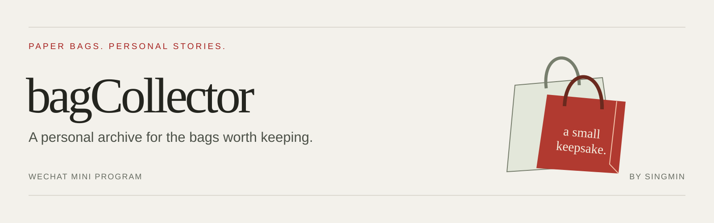

  

# bagCollector · 袋袋集

**Turn collectible paper bags into a visual collection you can revisit.**

bagCollector is a WeChat Mini Program for people who keep the paper bags behind a favorite drink, collaboration, or everyday memory. Discover curated designs, photograph your own finds, and organize them into a personal digital display.

Built and maintained by [Singmin](https://github.com/Singmin). This is the public product and engineering showcase, with the full application source code available in this repository.

[Product walkthrough](docs/WALKTHROUGH.md) · [Architecture & engineering](docs/ARCHITECTURE.md) · [Questions & feedback](https://github.com/Singmin/bagCollector/issues)

## See the product

<table>
  <tr>
    <th>Discover designs</th>
    <th>Build your own archive</th>
  </tr>
  <tr>
    <td align="center"></td>
    <td align="center"></td>
  </tr>
  <tr>
    <td>Browse featured bags and recent catalog additions. Save a design to your wishlist or mark it as collected.</td>
    <td>Group bags on named shelves, search your collection, and switch between shelf and grid views.</td>
  </tr>
</table>

These are real screenshots from a running WeChat DevTools development session, captured on **19 October 2026**. The current interface is in Chinese. Visible item counts describe that session, not platform usage. See [media notes](docs/MEDIA.md).

## What you can do

| Experience | Implemented behavior |
| --- | --- |
| **Discover & save** | Browse the curated catalog, keep a wishlist, and add catalog designs to a personal collection. |
| **Capture a find** | Take a photo or choose an image from the album; review similar catalog candidates or continue with a manual entry. |
| **Prepare the image** | Crop, rotate, adjust the image, and request background removal for a clean display image. |
| **Keep both sides** | Store front and optional back images, with independent processing and previews. |
| **Organize & revisit** | Use shelves, a grid, search, tags, notes, quantities, and a collection calendar. |
| **Share a keepsake** | Generate a share poster from a collection item. |
| **Maintain the catalog** | Use a separate admin console for catalog entries, reference images, scan feedback, and review workflows. |

## Engineering highlights

- **An image lifecycle, not a single upload.** Queue workers create display images and thumbnails from versioned sources. Per-side version checks prevent stale jobs from replacing newer edits; the last published image remains available while an update is processed.
- **Visual retrieval with explicit choices.** The matching implementation supports color/layout features and a configurable DINOv2 embedding service. Query and reference images share preprocessing; multiple references are ranked into a deduplicated candidate list for user confirmation.
- **A reviewable feedback loop.** Selected or corrected matches can enter a sample-review workflow. Approved images extend the reference library; this does **not** automatically retrain model weights.
- **A collection interface designed for browsing.** Shelf and grid layouts share collection state, with paginated loading, thumbnail caching, and on-demand detail retrieval.
- **Separated product and operations surfaces.** A typed API connects the mini-program, admin console, workers, relational data, and object storage.

See [architecture & tradeoffs](docs/ARCHITECTURE.md) for the system overview and implementation boundaries.

## Technology

| Layer | Stack verified in the implementation |
| --- | --- |
| Mini-program | uni-app · Vue 3 · TypeScript · Vite · WeChat Canvas 2D |
| API | Node.js · NestJS · Fastify · Zod |
| Admin console | React · TypeScript · Ant Design · Vite |
| Data & jobs | PostgreSQL · Prisma · Redis · BullMQ |
| Images & retrieval | Sharp · Tencent Cloud COS / image processing · color/layout features · DINOv2 integration |
| Delivery & checks | pnpm workspaces · Vitest · ESLint |

## Demo & verification scope

The [walkthrough](docs/WALKTHROUGH.md) explains the implemented user journey alongside the runtime screenshots. The current application target is a **WeChat Mini Program**; this repository does not provide a public browser demo or installable application package.

Descriptions were checked against the current implementation on 19 October 2026. The screenshots demonstrate the catalog and shelf interfaces. Capture, matching, editing, sharing, and admin behavior were reviewed in source; they were not all exercised end to end for this showcase. Model availability, selected matching engine, and cloud services depend on deployment configuration. No recognition-accuracy, latency, scale, or production-readiness metrics are claimed here.

## About this repository

This repository contains the full application source code, documentation, and presentation assets. Credentials, private keys, datasets, and internal service addresses have been removed and are excluded. The original application remains private.

The application implementation is not distributed under an open-source license. Brand names and artwork visible in the product screenshots belong to their respective owners; their appearance does not imply endorsement.

## Support the project

If you enjoy thoughtful tools for small collections, **[give bagCollector a Star](https://github.com/Singmin/bagCollector)** to support its development and make it easier to find again.

Have a product idea or a question about the design? [Open an issue](https://github.com/Singmin/bagCollector/issues/new). Please keep feedback free of personal data, credentials, and private service details.
