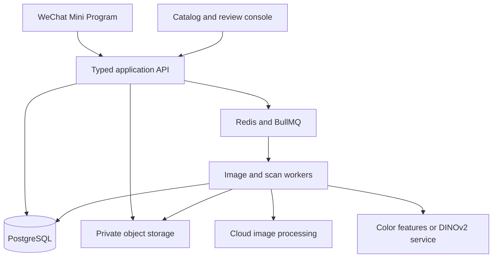

# Architecture & engineering

bagCollector combines a collection interface with an asynchronous image pipeline and a curated reference catalog. This overview describes the reviewed implementation, without publishing application code or deployment details.

## System overview

The mini-program is built with uni-app, Vue 3, and TypeScript. The React admin console serves catalog and review work. A NestJS API with the Fastify adapter handles application requests; shared TypeScript contracts and Zod schemas define request and response shapes. Prisma manages relational data in PostgreSQL, while Redis and BullMQ coordinate background work.

The diagram groups responsibilities for readability. It is not a network map and intentionally contains no hosts, ports, bucket names, or service addresses.

## Image processing and consistency

An uploaded image moves through normalization, optional editing/background removal, and publication of display assets and thumbnails. Sharp handles local image transformations; the current background-removal path integrates Tencent Cloud image processing and private object storage.

Front and back images have independent source, processing, and published versions. An asynchronous result must still match the current source before it can become the published image. This protects a newer upload, edit, or removal from being overwritten by an older queued job. A failed update can leave the previously published image available for display.

Catalog-backed collection entries reuse catalog imagery, while personal organization and metadata remain associated with the user's collection record. Catalog maintenance and personal edits serve different responsibilities.

## Retrieval, not an unsupported accuracy claim

The scan pipeline normalizes query and reference images through a shared preprocessing contract. The implementation offers two configurable retrieval paths:

- **Color/layout features:** a compact descriptor based on color distribution, spatial layout, coarse structure, and image statistics.
- **DINOv2 integration:** visual embeddings supplied by a separate inference service, combined with color similarity during ranking.

Multiple references can represent a catalog design. Ranking keeps the strongest score per design, applies configured candidate limits and thresholds, and presents choices for the user to confirm or correct. Model identifiers and source versions help keep incompatible or stale embeddings out of ranking.

The current primary scan-reference selection uses front-side catalog assets and reference images. The ability to store a back image does not establish that both sides participate in recognition.

User feedback and approved reference samples improve reference coverage. There is no claim of automatic weight updates, fine-tuning, or a newly trained model. The source default and an optional service integration do not establish which engine a live deployment currently uses. No benchmark results are published in this showcase.

## Collection experience

Shelf and grid views use a shared collection service, including search, pagination, thumbnail caching, and refresh coordination. Detailed records and larger artwork are retrieved when needed. The collection calendar groups items by their collection dates; share posters use the WeChat canvas APIs.

The interface also includes animated card presentation. Simulator screenshots establish the appearance shown in the gallery; device-motion behavior requires a separate physical-device check.

## Delivery and validation

The private project uses pnpm workspaces, TypeScript checks, ESLint, Vitest, and integration-check scripts. GitHub Actions coordinates validation and container delivery; deployment scripts include artifact verification and service-health checks. Docker Compose and Nginx form part of the deployment stack.

These are implementation capabilities, not a report that a new production deployment or a full test suite ran as part of this documentation publication. This work only publishes the showcase repository.

[Back to the showcase](../README.md)
