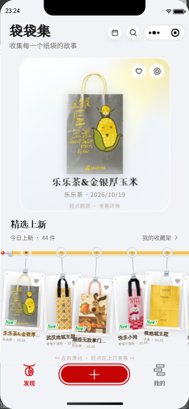
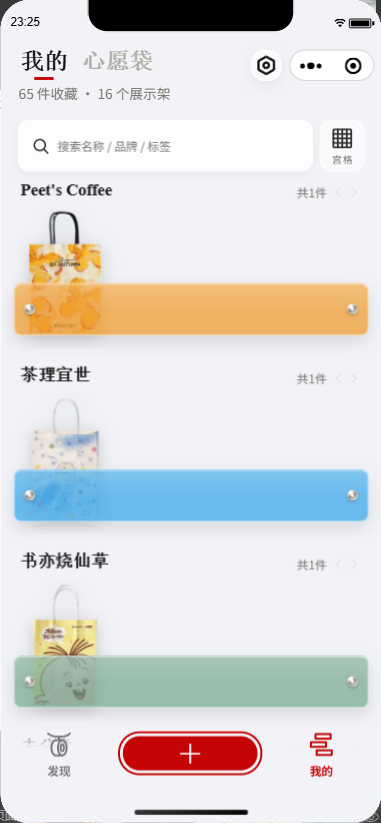

# Product walkthrough

The product helps a collector move from finding a design to preserving it in a personal archive. The two images below were captured from the running mini-program in WeChat DevTools. Other steps describe source-reviewed behavior and are not presented as a recorded end-to-end demo.

## 1. Discover a design

The discovery screen combines a featured bag with a horizontal rail of recent catalog additions. Open a design, save it to a wishlist, or mark it as already collected.

## 2. Capture a personal find

Use the central add action to take a photo or choose an existing image. The matching flow can return similar catalog candidates for confirmation. If the desired design is not found, the interface supports correction/search and a manual-entry path.

Matching is a suggestion step. A candidate is not a guarantee of identity or a published accuracy result.

## 3. Prepare the collection image

The editing flow supports cropping, rotation, image adjustments, and background removal. A collection item can have a front image and an optional back image. These sides are processed independently.

The pipeline produces display images and thumbnails while retaining source/version information. Background removal depends on the configured cloud service.

## 4. Give it a place

Organize items into named shelves, or switch to a grid when you want a compact overview. Search and metadata help find a bag later; a separate wishlist keeps future finds alongside the collection.

## 5. Revisit and share

The collection calendar groups finds by date. Item details provide a place for tags, quantities, and notes. A canvas-based sharing flow creates a poster from an item.

## Behind the catalog

A separate admin application maintains catalog entries and reference images, reviews scan feedback, and manages approved samples. Approved reference additions expand the image library used for retrieval; they do not automatically train a model.

## Access

This showcase provides screenshots and documentation. No public browser application, WeChat access code, or downloadable build is included. Questions and feedback are welcome through [GitHub Issues](https://github.com/Singmin/bagCollector/issues).

[Back to the showcase](../README.md) · [Media notes](MEDIA.md)
